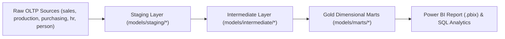

# AdventureWorks Dimensional Modeling & ELT Pipeline (dbt, SQL, Databricks & Power BI)

> **Context & Repository History:**  
> This project implements a Kimball Star Schema dimensional model using **dbt Core**, **SQL**, **Databricks Unity Catalog**, and **Power BI** over the classic **AdventureWorks** ERP dataset (Sales, Customers, Production, Purchasing, Inventory, and HR).  
> *Note on Git history:* This project was originally developed during my Analytics Engineering certification training and later extracted from a consolidated personal monorepo into this standalone repository.

---

## 1. Architecture & Lineage (`Staging` ➔ `Intermediate` ➔ `Marts`)

The dbt project transforms 60+ raw OLTP tables from the AdventureWorks relational schema into clean, tested dimensional marts:



### Layer Breakdown
1. **Staging (`models/staging/`):**
   - 1-to-1 source standardization (`stg_sales__*`, `stg_production__*`, `stg_purchasing__*`, `stg_humanresources__*`, `stg_person__*`).
   - Handles column renaming, data type casting, and basic source-level schema tests (`_src_*.yml`).
2. **Intermediate (`models/intermediate/`):**
   - Joins normalized OLTP header/detail tables and applies business logic before aggregation:
     - `int_sales_order_lines_enriched.sql`, `int_customers_unified.sql`, `int_sales_reps_enriched.sql`
     - `int_work_orders_enriched.sql`, `int_inventory_transactions_unioned.sql`, `int_products_enriched.sql`
     - `int_purchase_order_lines_enriched.sql`, `int_vendors_enriched.sql`
3. **Marts (`models/marts/` — Kimball Star Schema):**
   - **Fact Tables:** `fct_sales.sql`, `fct_work_orders.sql`, `fct_inventory_snapshots.sql`, `fct_purchases.sql`
   - **Dimension Tables:** `dim_customers.sql`, `dim_products.sql`, `dim_sales_reps.sql`, `dim_vendors.sql`, `dim_employees.sql`, `dim_dates.sql`
4. **Data Quality & Singular Tests (`tests/`):**
   - Schema constraints (`unique`, `not_null`, `relationships`) defined in `_marts_*.yml`.
   - Custom singular business-rule assertions:
     - `assert_positive_revenue.sql`
     - `assert_stocked_le_ordered.sql`
     - `assert_valid_rejection_rates.sql`
     - `assert_valid_sales_dates.sql`

---

## 2. Running the dbt Project

### Prerequisites
- Python `3.11+` and `dbt-databricks` (see `requirements.txt`).
- A Databricks SQL Warehouse loaded with the raw `adventure_works` source schemas declared in `models/staging/*/_src_*.yml`.

```bash
python -m venv .venv
source .venv/bin/activate  # Windows: .\.venv\Scripts\Activate.ps1
pip install -r requirements.txt

# Configure your Databricks connection in ~/.dbt/profiles.yml using profiles.example.yml
dbt deps
dbt compile
dbt build
```

---

## 3. Power BI Report (`.pbix`) & Visual Previews

- **Power BI File ([`dashboard/AdventureWorks_Executive_Analytics_Platform.pbix`](dashboard/AdventureWorks_Executive_Analytics_Platform.pbix)):**
  - The `.pbix` file includes the cached VertiPaq data model and 100% native visuals (using a **Clustered Bar Chart with Country ➔ State/Province drill-down** instead of legacy map visuals that trigger Bing/Azure Maps deprecation popups) so you can open it directly in **Power BI Desktop** offline without any popups or an active cloud connection.
  - *Note for live refresh:* The Power Query (`M`) connection in the `.pbix` points to the development Databricks SQL Warehouse used when the certification project was built. To refresh the data against your own Databricks environment after running `dbt build`, open **Transform data ➔ Data source settings** in Power BI Desktop and update the Databricks Server Hostname and HTTP Path to your workspace.
- **Static Page Previews (`dashboard/powerbi_backgrounds/`):**
  - `dash_pg_01_vendas.png` — Commercial & Sales Performance
  - `dash_pg_02_clientes.png` — Customer Segmentation, Retention & Regional Revenue Breakdown (Country/State Drill-down)
  - `dash_pg_03_producao.png` — Manufacturing & Work Order Efficiency
  - `dash_pg_04_estoque.png` — Inventory Turnover & Stock Levels
  - `dash_pg_05_compras.png` — Vendor Lead Times & Purchasing
  - `dash_pg_06_rh.png` — Headcount & Department Analytics
