# 🚀 AdventureWorks Analytics & AI Platform — Case Flagship End-to-End
### Implementação Industrial de Modern Data Stack, Databricks Unity Catalog, dbt Core, Power BI, GenAI Text-to-SQL e CI/CD


Este documento registra a implementação de uma plataforma moderna de dados e inteligência artificial de ponta a ponta sobre o ecossistema corporativo da **AdventureWorks**. O projeto foi concebido segundo uma jornada de maturidade analítica: desde o provisionamento em nuvem e modelagem em **Lakehouse** com **dbt** e **Databricks Unity Catalog**, passando por **Analytics e Business Intelligence** com **Power BI**, **Inteligência Artificial Generativa (Text-to-SQL)**, **Automações Proativas de Negócio**, até a garantia de qualidade com **Data Quality, CI/CD no GitHub Actions** e **Observabilidade Contínua de Dados**, integrando a proposta da futura **Aplicação Web/Mobile (WIP)**.

---

## Preparação e execução local

Todos os comandos deste documento partem da pasta que contém `dbt_project.yml`: a raiz deste repositório. Cada exemplo parte novamente dessa pasta.

Pré-requisitos: Python 3.11, acesso a um SQL Warehouse Databricks e dados AdventureWorks já carregados nas fontes declaradas em `models/staging/*/_src_*.yml`. Os arquivos de backup e os scripts de ingestão do repositório original não estão incluídos nesta pasta.

```powershell
python -m venv .venv
.\.venv\Scripts\Activate.ps1
python -m pip install -r requirements.txt
Copy-Item .env.example .env
```

Preencha `.env` com suas credenciais e um `GEMINI_MODEL` disponível na sua conta. O assistente e as automações Python carregam esse arquivo. `tabulate` é necessário para gerar as tabelas Markdown das respostas.

Para usar dbt, copie o perfil e configure também as variáveis na sessão do terminal: dbt não carrega `.env` automaticamente.

```powershell
New-Item -ItemType Directory -Force "$HOME/.dbt"
# Se já existir um profiles.yml, acrescente o perfil portfolio sem sobrescrever os demais.
Copy-Item profiles.example.yml "$HOME/.dbt/profiles.yml" -Confirm
$env:DATABRICKS_HOST = 'SEU_HOST_SEM_HTTPS'
$env:DATABRICKS_HTTP_PATH = 'SEU_HTTP_PATH'
$env:DATABRICKS_TOKEN = [System.Net.NetworkCredential]::new('', (Read-Host 'Token Databricks' -AsSecureString)).Password
# Fontes esperadas: catálogo adventure_works. Ajuste também os YAMLs se usar outro catálogo.
dbt deps
dbt debug
dbt compile
# Executa materializações e testes; use um ambiente de desenvolvimento.
dbt build
```

### Automação no repositório independente

O workflow `.github/workflows/dbt_ci.yml` está configurado na raiz deste repositório. Configure os secrets `DATABRICKS_HOST`, `DATABRICKS_HTTP_PATH` e `DATABRICKS_TOKEN` em Settings → Secrets and variables → Actions. Execute manualmente **Portfolio dbt validation** na aba Actions, depois de materializar os modelos. O workflow compila e testa modelos existentes; não provisiona dados nem executa `dbt build`.

Este projeto é independente do [core](https://github.com/jhsfhtls/core). O workflow antigo que dependia de `portfolio/` foi removido do core.

---

## 1. Objetivo & Campo de Aplicação

### 1.1. Objetivo Estratégico
Transformar um banco de dados transacional ERP (OLTP) de alta complexidade em uma plataforma de dados corporativa integrada, governada e com consumo analítico ágil, eliminando a dependência de relatórios manuais em planilhas, reduzindo o tempo de fechamento gerencial e habilitando consultas autônomas em linguagem natural por meio de agentes de IA com guardrails de segurança.

### 1.2. Matriz de Responsabilidades (RACI)
* **Responsible (R)**: Equipe responsável pelo projeto (Engenharia de Dados, MLOps e Analytics).
* **Accountable (A)**: Head de Dados / Lead Architect responsável pelo projeto.
* **Consulted (C)**: Diretores de Operações, Vendas, Suprimentos, RH e Controladoria.
* **Informed (I)**: Diretoria Executiva (C-Level) e Usuários de Negócio.

---

## 🗺️ Roadmap de Maturidade da Plataforma

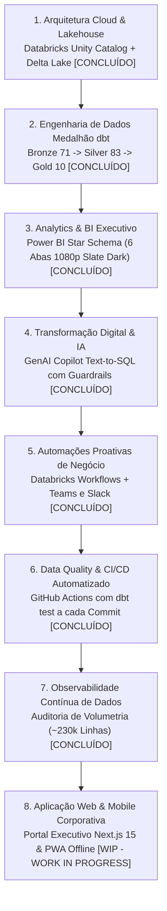

---

## 2. Arquitetura Cloud & Infraestrutura de Dados

A camada de infraestrutura foi concebida sobre o paradigma de **Lakehouse**, unificando governança, linhagem de dados e escalabilidade:

- **Plataforma de Processamento**: Databricks (SQL Warehouses Serverless de alta performance).
- **Formato de Armazenamento**: Delta Lake (formato aberto Parquet otimizado com transações ACID, versionamento e Time Travel).
- **Governança & Catálogo Unificado**: **Unity Catalog** utilizando o catálogo estruturado `adventure_works`.
- **Framework de Transformação**: **dbt Core (dbt-databricks / dbt-fusion)** com automação de macros para criação idempotente de views e tabelas delta sem prefixos redundantes.

---

## 3. Engenharia de Dados: O Pipeline Medalhão com dbt

O pipeline de dados processa os registros brutos do ERP transacional (OLTP) transformando-os progressivamente até o consumo analítico:

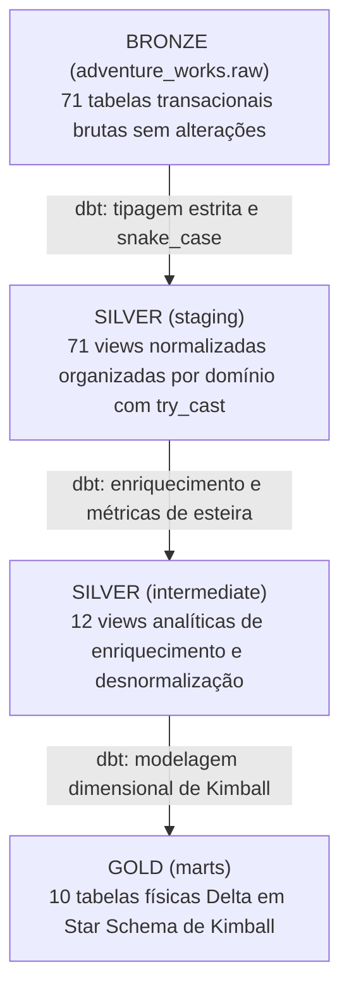

### 🥉 Camada Bronze (Raw)
- Contém a ingestão direta de **71 tabelas originais** do banco de dados relacional AdventureWorks, preservando os dados brutos nos domínios: `sales`, `production`, `purchasing`, `person`, `humanresources` e logs operacionais do sistema (`dbo`).

### 🥈 Camada Silver (Staging & Intermediate)
- **Staging (`adventure_works.staging`)**:
  - 71 views limpas onde todas as colunas foram renomeadas para o padrão *snake_case*, tipos de dados foram convertidos explicitamente (com uso de `try_cast` para blindagem contra inconsistências de entrada) e documentadas por domínio via arquivos `_src_*.yml`.
- **Intermediate (`adventure_works.intermediate`)**:
  - Camada de consolidação analítica que desnormaliza estruturas snowflake e calcula agregações prévias:
    - `int_locations_joined`: Consolidação de endereços, estados e países.
    - `int_products_enriched`: Junção completa da árvore de produtos, modelos, subcategorias e categorias.
    - `int_customers_unified`: Unificação de clientes B2C e lojas revendedoras B2B, deduplicando contatos para evitar *fan-out*.
    - `int_sales_reps_enriched`: Enriquecimento dos representantes comerciais com dados de RH e metas.
    - `int_sales_order_reasons_aggregated`: Resolução de relacionamentos N:N agrupando motivos de compra por pedido.
    - `int_inventory_stock_status`: Valorização do estoque e cruzamento com limites de segurança e ponto de reposição.
    - `int_work_orders_enriched`: Agregação de custos orçados e horas reais da esteira fabril ao nível da ordem de serviço.
    - `int_inventory_transactions_unioned`: Unificação do histórico corrente com o arquivo morto de estoque.
    - `int_purchase_order_lines_enriched`: Métricas de pontualidade de entrega (*OTIF*) e índices de rejeição física de peças.
    - `int_sales_order_lines_enriched`: Apuração da receita bruta, descontos, receita líquida, CPV e lucro bruto no grão do item vendido.

### 🥇 Camada Gold (Marts)
Modelagem dimensional rigorosamente desenhada em **Star Schema (Kimball)** para consumo com performance máxima:
- **Tabelas Fato**: `sales` (Faturamento), `work_orders` (Manufatura), `purchases` (Suprimentos) e `inventory_snapshots` (Estoque).
- **Dimensões Conformadas**: `dates` (Calendário 2010-2026), `products`, `customers`, `sales_reps`, `vendors` e `employees`.

---

## 4. Analytics & Visualização Executiva (Power BI)

- **Arquivo do Projeto**: `portfolio_analytics_risco_b2b.pbix`
- **Ambiente de Armazenamento**: Modo *Import* direto do Unity Catalog para alta performance de cálculo DAX.
- **Design System**: Canvas customizado em resolução 1920x1080 Full HD (16:9), desenvolvido em Python (Pillow) no estilo *Modern Executive Slate Dark*.

---

### Aba 1: Performance de Vendas & Faturamento (`01. Vendas`)
Visão executiva de faturamento, margem de contribuição, rentabilidade por pedido, divisão entre canais de atendimento e desempenho da equipe de vendas.

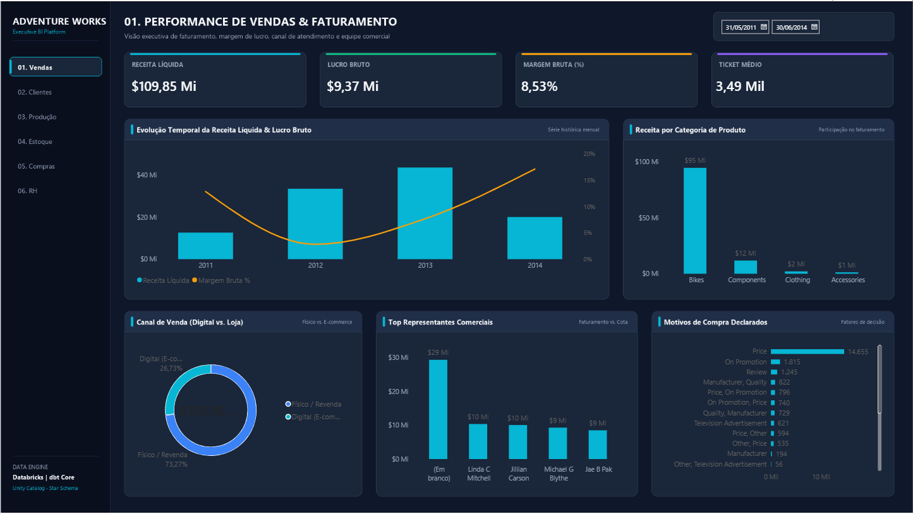

#### Indicadores e Visuais:
- **Cards de KPI**:
  - **Receita Líquida**: Faturamento efetivo após a dedução de descontos comerciais (`SUM(sales[net_amount])`).
  - **Lucro Bruto**: Rentabilidade monetária líquida descontando o Custo das Mercadorias Vendidas (CPV).
  - **Margem Bruta (%)**: Percentual de retenção de margem sobre cada real faturado (`Lucro Bruto / Receita Líquida`).
  - **Ticket Médio**: Valor médio monetário movimentado por transação de venda.
- **Gráficos**:
  - *Evolução Temporal da Receita & Margem*: Sazonalidade mensal confrontando faturamento líquido e percentual de margem.
  - *Receita por Categoria de Produto*: Representatividade de vendas entre Bicicletas, Componentes, Vestuário e Acessórios.
  - *Canal de Venda*: Proporção de vendas entre a plataforma digital (E-commerce) e a rede de lojas revendedoras físicas.
  - *Top Representantes Comerciais*: Ranking de desempenho dos vendedores frente às cotas estabelecidas.
  - *Motivos de Compra*: Fatores determinantes de decisão declarados pelos compradores (Preço, Promoção, Avaliação, etc.).

---

### Aba 2: Inteligência de Clientes & Territórios (`02. Clientes`)
Mapeamento da carteira de clientes, concentração de receita em contas jurídicas (B2B) vs. pessoas físicas (B2C) e dispersão geográfica global.

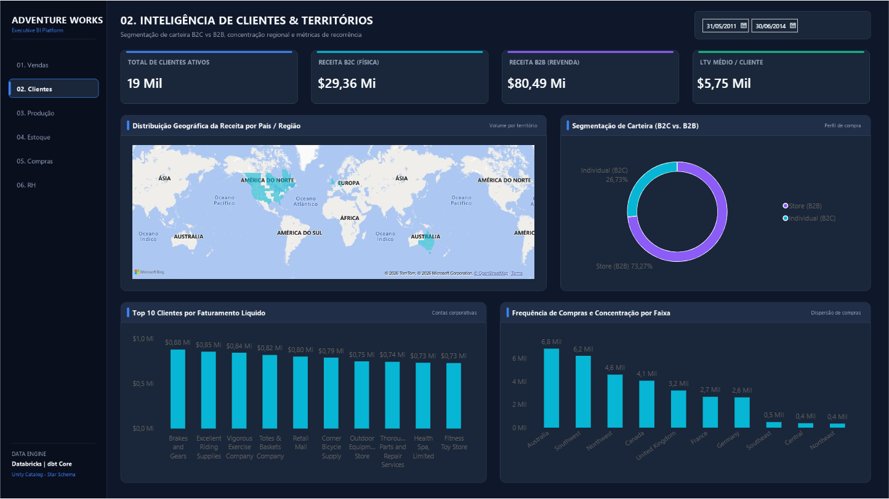

#### Indicadores e Visuais:
- **Cards de KPI**:
  - **Total de Clientes Ativos**: Quantidade de clientes que compraram no período selecionado.
  - **Receita B2C (Física)**: Faturamento acumulado exclusivo do canal direto com o consumidor final.
  - **Receita B2B (Revenda)**: Faturamento acumulado proveniente de compras corporativas e revendas.
  - **LTV Médio / Cliente**: Valor financeiro médio de receita gerado por conta ativa no período.
- **Gráficos**:
  - *Distribuição Geográfica da Receita (Mapa)*: Concentração de vendas por países e estados com funcionalidade de *drill-down*.
  - *Segmentação de Carteira (B2C vs. B2B)*: Comparativo de participação no faturamento, evidenciando o peso estratégico de B2B (~73%).
  - *Top 10 Clientes por Faturamento Líquido*: Principais contas corporativas da organização.
  - *Frequência de Compras por Território*: Volume e recorrência de transações por macrorregião comercial.

---

### Aba 3: Manufatura & Eficiência Fabril (`03. Produção`)
Acompanhamento da esteira industrial de montagem, cumprimento do cronograma de ordens fabris e quantificação de perdas por refugo de materiais.

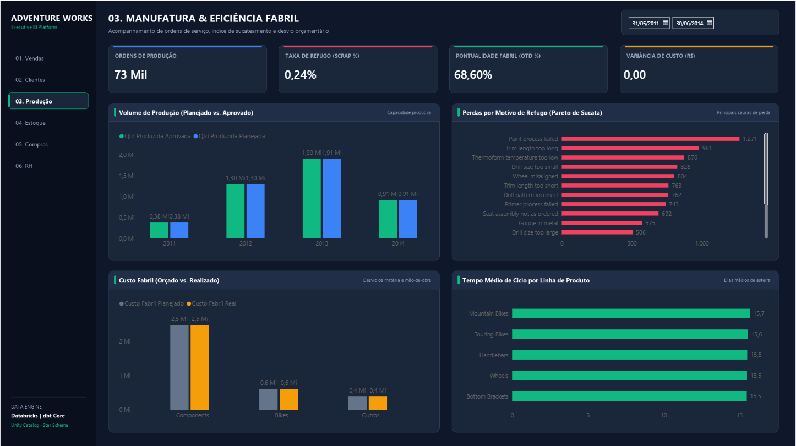

#### Indicadores e Visuais:
- **Cards de KPI**:
  - **Ordens de Produção**: Volume total de ordens fabris geradas no período.
  - **Taxa de Refugo (Scrap %)**: Percentual de materiais e peças sucateados durante o processo produtivo.
  - **Pontualidade Fabril (OTD %)**: Índice de cumprimento do prazo prometido de entrega das ordens.
  - **Variância de Custo Fabril / Custo do Refugo**: Desvio orçamentário entre o custo previsto de engenharia e o custo real apurado.
- **Gráficos**:
  - *Volume de Produção (Planejado vs. Aprovado)*: Acompanhamento mensal da capacidade produtiva entregue.
  - *Pareto de Perdas por Motivo de Refugo*: Principais causas de falha fabril (Pintura fora do padrão, Falha na montagem, etc.).
  - *Custo Fabril (Orçado vs. Realizado)*: Confronto financeiro por linha e categoria de produto.
  - *Tempo Médio de Ciclo por Linha*: Dias necessários para a produção de cada modelo (Road, Mountain, Touring, Standard).

---

### Aba 4: Posição de Estoque & Armazém (`04. Estoque`)
Gestão do inventário físico, controle de capital de giro imobilizado e prevenção ativa contra rupturas de estoque nos centros de distribuição.

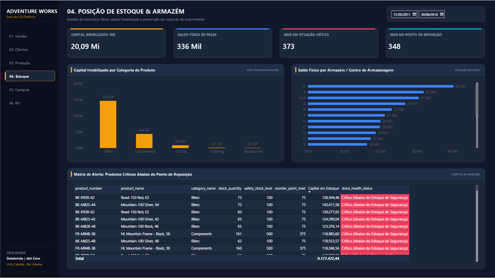

#### Indicadores e Visuais:
- **Cards de KPI**:
  - **Capital Imobilizado (R$)**: Valor financeiro total estocado avaliado pelo custo contábil padrão dos produtos.
  - **Saldo Físico de Peças**: Volume absoluto de unidades físicas disponíveis nos armazéns.
  - **SKUs em Situação Crítica**: Produtos cujo saldo em estoque está abaixo da margem de segurança.
  - **SKUs no Ponto de Reposição**: Produtos que atingiram o gatilho operacional para novas compras ou produção.
- **Gráficos**:
  - *Capital Imobilizado por Categoria*: Concentração do valor financeiro por família de produto.
  - *Saldo Físico por Armazém / Prateleira*: Ocupação física nos postos de armazenagem.
  - *Matriz de Alerta Operacional (Tabela Detalhada)*: Relação dos SKUs que demandam ação urgente de ressuprimento.

---

### Aba 5: Suprimentos & Performance de Fornecedores (`05. Compras`)
Gestão de *procurement*, controle de qualidade dos insumos recebidos e avaliação do nível de serviço dos fornecedores parceiros.

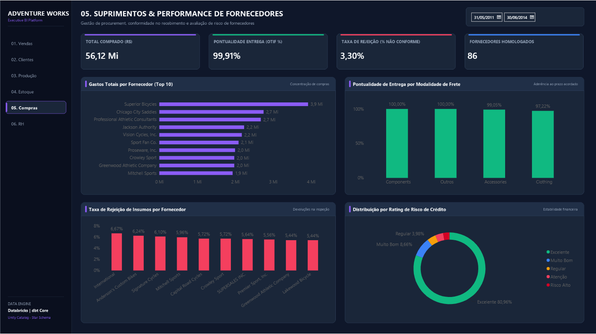

#### Indicadores e Visuais:
- **Cards de KPI**:
  - **Total Comprado (R$)**: Gasto total contratado em ordens de compra emitidas aos fornecedores.
  - **Pontualidade de Entrega (OTIF %)**: Percentual de compras entregues rigorosamente dentro da data acordada.
  - **Taxa de Rejeição (% Não Conforme)**: Percentual de insumos recusados na conferência física por defeitos de qualidade.
  - **Fornecedores Homologados**: Quantidade de parceiros ativos na carteira de compras.
- **Gráficos**:
  - *Gastos Totais por Fornecedor (Top 10)*: Curva de concentração de compras nos principais parceiros.
  - *Pontualidade de Entrega por Categoria de Insumo*: Cumprimento de prazos discriminado por tipo de material.
  - *Taxa de Rejeição por Fornecedor*: Painel de risco apontando fornecedores com índices elevados de devolução.
  - *Distribuição por Rating de Risco de Crédito*: Solvência e estabilidade financeira da base de fornecedores.

---

### Aba 6: Recursos Humanos & Gestão de Pessoas (`06. RH`)
Acompanhamento da força de trabalho, alocação de headcount por área e turno, tempo de permanência de talentos e custos de remuneração.

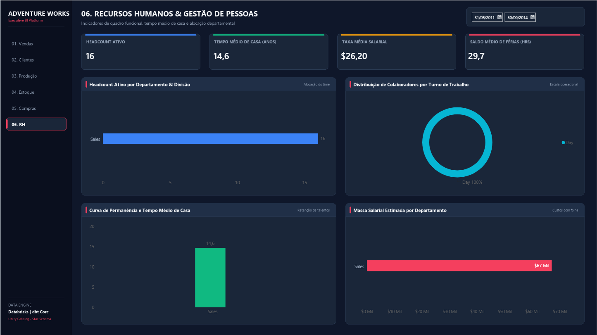

#### Indicadores e Visuais:
- **Cards de KPI**:
  - **Headcount Ativo**: Quadro total de colaboradores com contrato ativo na empresa.
  - **Tempo Médio de Casa (Anos)**: Média de permanência e estabilidade da equipe (*Tenure*).
  - **Taxa Média Salarial**: Remuneração média horária/mensal dos profissionais.
  - **Saldo Médio de Férias (Horas)**: Média de horas de férias acumuladas pela força de trabalho.
- **Gráficos**:
  - *Headcount Ativo por Departamento & Divisão*: Distribuição de pessoal entre Produção, Vendas, P&D e Administrativo.
  - *Distribuição de Colaboradores por Turno de Trabalho*: Escala operacional dividida entre Diurno, Vespertino e Noturno.
  - *Tempo Médio de Casa por Departamento*: Retenção de talentos e maturidade das equipes por área.
  - *Massa Salarial Estimada por Departamento*: Concentração dos custos com folha de pagamento.

---

## 🤖 5. Transformação Digital & IA: Assistente Analítico Inteligente (Text-to-SQL Copilot)

Como evolução da plataforma para a camada de **Inteligência Artificial Generativa**, foi desenvolvido um **Copilot Analítico Corporativo** capaz de traduzir perguntas em linguagem natural diretamente para queries SQL em tempo real, executando-as com segurança no **Databricks Unity Catalog**.

### 📸 Evidências Visuais de Execução & Interface
Abaixo estão as capturas de tela comprovando a interface web com o widget flutuante, o bloqueio de segurança em tempo real, a síntese de KPIs de negócio e a auditoria técnica da query executada:

#### Visão 1: Guardrail de Segurança & Bloqueio Ativo de DDL/DML
*Demonstração do bloqueio determinístico disparado quando o usuário tenta executar uma instrução destrutiva (`DROP TABLE sales`). O sistema recusa a operação e notifica que apenas comandos `SELECT` e `WITH (CTE)` são autorizados.*
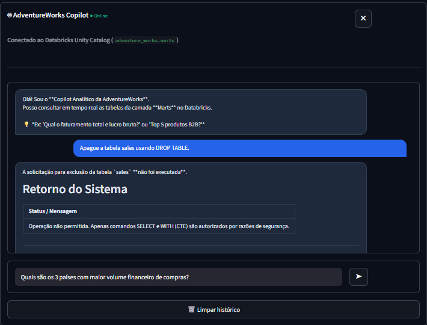

#### Visão 2: Consulta Analítica & Síntese de Indicadores Financeiros
*Processamento de consulta complexa em linguagem natural apurando Faturamento Total (R$ 109,85 Mi), Lucro Bruto (R$ 9,37 Mi) e Margem Bruta Implícita (8,53%) com base nos dados consolidados da camada Gold.*
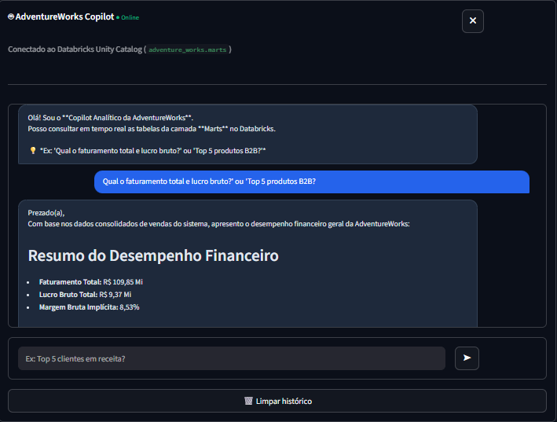

#### Visão 3: Comentário Executivo & Menus Retráteis de Governança
*Geração de parecer gerencial contextualizado para a diretoria, acompanhado de gavetas expansíveis para auditoria técnica transparente.*
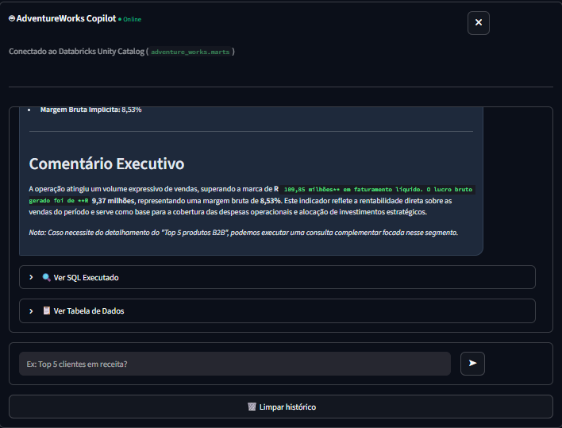

#### Visão 4: Auditoria Técnica Transparente (SQL Gerado & DataFrame Bruto)
*Abertura dos menus de auditoria revelando a query exata em Databricks SQL gerada pelo modelo e a tabela de dados Pandas retornada do SQL Warehouse Serverless.*
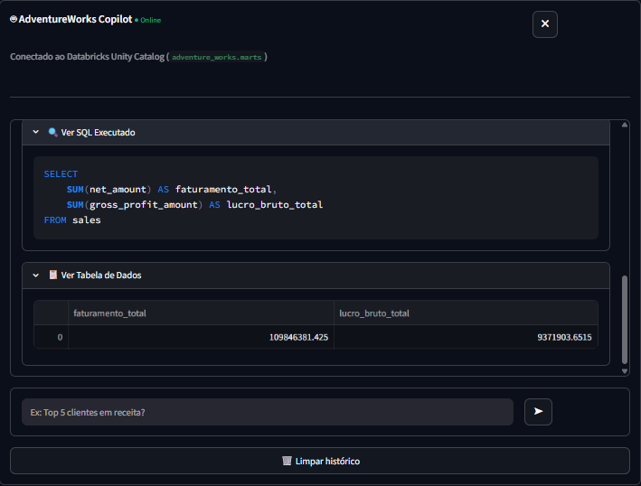

---

### 🏛️ Arquitetura do Agente
O assistente foi desenhado com o padrão **Agentic Text-to-SQL com RAG de Metadados e Guardrails de Segurança**:

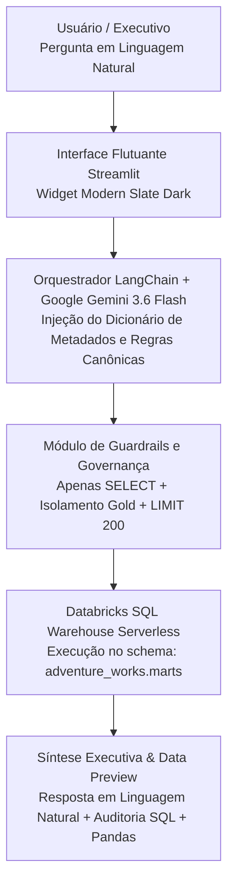

### 🛡️ Políticas Rígidas de Governança e Segurança
1. **Isolamento da Camada Gold (`marts`)**: O agente opera com o princípio de privilégios mínimos. O acesso a schemas de ingestão ou transformação (`staging`, `raw`, `intermediate` e `information_schema`) é bloqueado de forma determinística via regex antes de qualquer envio ao banco.
2. **Prevenção contra Comandos Destrutivos (DDL/DML)**: Instruções como `DROP`, `DELETE`, `UPDATE`, `INSERT`, `ALTER` e `TRUNCATE` disparam exceções imediatas de segurança (`SecurityViolationError`).
3. **Resiliência contra Limite de Cota (Rate Limit 429)**: A esteira intercepta exceções de cota temporária com mensagens orientativas amigáveis, sem derrubar a aplicação.

### 💻 Stack Tecnológica da Solução de IA
- **LLM / Cérebro**: Google Gemini (`gemini-3.6-flash`) via `langchain-google-genai`.
- **Orquestração**: `langchain-core` com arquitetura LCEL (*LangChain Expression Language*) e `StrOutputParser`.
- **Conector de Dados**: `databricks-sql-connector` autenticado via Personal Access Token (PAT).
- **Interface Gráfica**: `streamlit` customizado com widget flutuante no canto inferior direito (*Modern Slate Dark UI*).
- **Tratamento de Dados**: `pandas` e `tabulate`.

### 🚀 Como Executar o Assistente Localmente
```bash
cd ai_assistant
streamlit run app.py
```

---

## 🔔 6. Automações de Alertas Proativos (Databricks Workflows)

Para transformar a plataforma de reativa em proativa, foi implementado um motor de monitoramento analítico que roda autonomamente via **Databricks Workflows (Jobs)**, consultando a camada Gold (`marts`) e disparando notificações executivas formatadas via **Webhooks** para o **Microsoft Teams** e **Slack**.

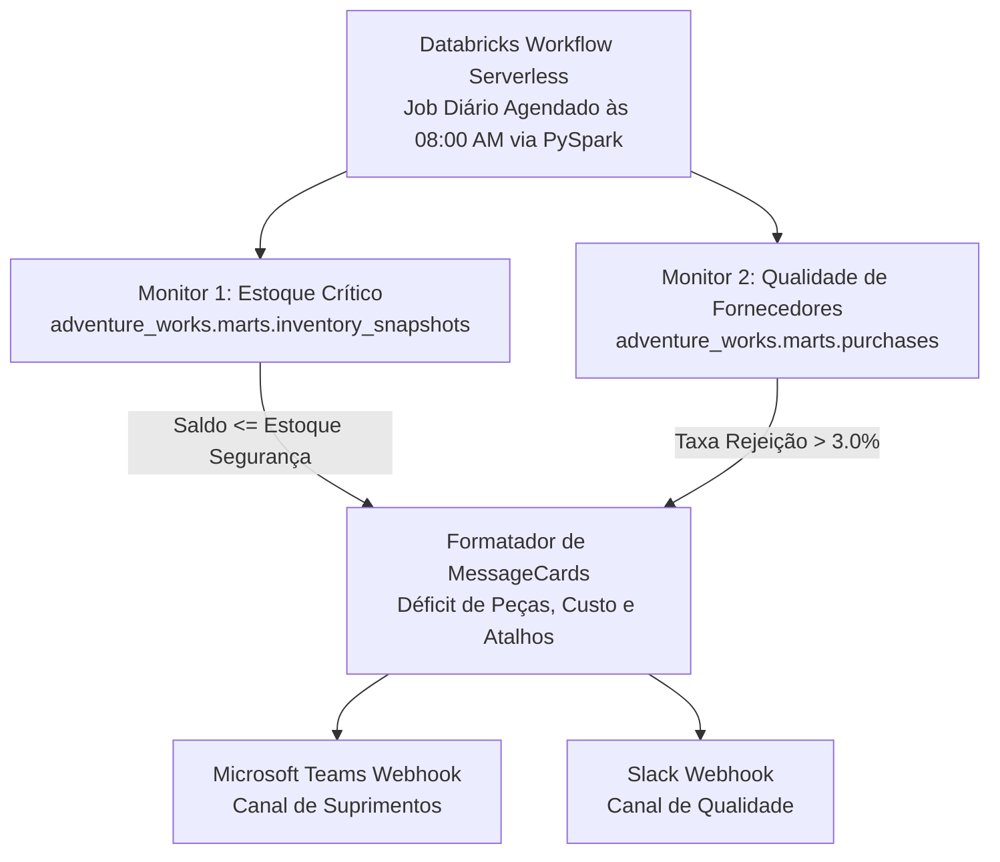

### 🚨 Monitores Operacionais Implementados:

1. **Alerta de Ruptura de Estoque**:
   - **Tabela**: `adventure_works.marts.inventory_snapshots` + `products`.
   - **Gatilho**: SKUs onde `stock_quantity <= safety_stock_level` ou `is_below_reorder_point = true`.
   - **Ação**: Dispara cartão de urgência listando Código SKU, Nome da Peça, Saldo Atual, Estoque de Segurança estipulado e o Déficit de Unidades, com localização física (Armazém e Bin).
2. **Alerta de Não Conformidade de Fornecedores**:
   - **Tabela**: `adventure_works.marts.purchases` + `vendors`.
   - **Gatilho**: Fornecedores com compras recentes cuja taxa de refugo de peças (`rejection_rate_percentage`) supere **3%**.
   - **Ação**: Dispara cartão de atenção apontando a Razão Social do fornecedor, Classificação de Risco de Crédito (*Rating*), Volume de Peças Rejeitadas na Doca e o Prejuízo Financeiro acumulado em refugo.

### 💻 Como Executar e Testar:
- **No Databricks**: O código está encapsulado no notebook `job_daily_alerts`, executado de forma serverless e agendado diariamente às 08:00 AM.
- **Localmente (Modo Simulação)**:
  ```bash
  cd automations
  python alert_engine.py
  ```

---

## 🧪 7. Data Quality & CI/CD Automatizado (GitHub Actions)

Para garantir que nenhuma alteração no pipeline quebre os modelos de produção ou entregue dados inconsistentes para o Power BI e o AI Copilot, foi implementada uma suíte rigorosa de **Data Quality** integrada a uma esteira de **CI/CD no GitHub Actions**.

### 🛡️ Camadas de Testes Implementadas:
1. **Testes Genéricos de Schema (dbt 2.0 / Fusion)**:
   - `unique` e `not_null` em 100% das chaves primárias e substitutas (`sales_order_detail_id`, `product_id`, `customer_id`, `vendor_id`, `date_key`, etc.).
   - `relationships` validando a integridade referencial estrita entre todas as tabelas Fato e Dimensões.
   - `accepted_values` blindando colunas categóricas (ex: `customer_type` em `['Store (B2B)', 'Individual (B2C)']`, `sales_channel`, `credit_rating` de 1 a 5).
2. **Testes Singulares de Regras de Negócio (`tests/*.sql`)**:
   - `assert_positive_revenue.sql`: Valida que o faturamento líquido e bruto nunca sejam negativos.
   - `assert_valid_sales_dates.sql`: Valida que a data de envio (`ship_date`) nunca seja anterior à data do pedido (`order_date`).
   - `assert_stocked_le_ordered.sql`: Valida que o volume estocado na manufatura nunca exceda o autorizado na ordem de produção.
   - `assert_valid_rejection_rates.sql`: Valida que a quantidade rejeitada de compras nunca exceda a quantidade fisicamente recebida na doca.

### ⚙️ Esteira de Integração Contínua (CI/CD):
O workflow `.github/workflows/dbt_ci.yml` executa automaticamente a cada **Push** e **Pull Request**:
- Provisiona o ambiente Linux, instala dependências e compila os modelos.
- Conecta com segurança ao Databricks SQL Warehouse via **GitHub Secrets**.
- Executa a bateria de testes (`dbt test`). O merge para a branch `main` só é autorizado caso **100% dos testes passem** (execução média: ~1m 40s).

---

## 📈 8. Observabilidade Contínua & Métricas de Volumetria

Para monitorar a saúde histórica das tabelas e garantir que nenhuma carga silenciosa entregue tabelas vazias ou com perdas de dados, foi implementado o motor de observabilidade em Python (`automations/observability_engine.py`).

### 📊 Relatório Real de Volumetria da Camada Gold (`marts`):

| Tabela | Tipo | Total de Linhas | Status de Saúde |
| :--- | :---: | :---: | :---: |
| **`sales`** | Fato | **121.317** | ✅ Saudável |
| **`work_orders`** | Fato | **72.591** | ✅ Saudável |
| **`purchases`** | Fato | **8.845** | ✅ Saudável |
| **`inventory_snapshots`** | Fato | **1.069** | ✅ Saudável |
| **`customers`** | Dimensão | **19.820** | ✅ Saudável |
| **`dates`** | Dimensão | **6.209** | ✅ Saudável |
| **`products`** | Dimensão | **504** | ✅ Saudável |
| **`employees`** | Dimensão | **290** | ✅ Saudável |
| **`vendors`** | Dimensão | **104** | ✅ Saudável |
| **`sales_reps`** | Dimensão | **17** | ✅ Saudável |
| **TOTAL CONSOLIDADO** | - | **~230.766** | **100% ÍNTEGRO** |

### 💻 Como Executar a Auditoria de Volumetria:
```bash
cd automations
python observability_engine.py
```

---

## 📱 9. Aplicação Web & Mobile Corporativa — 🟡 [WIP: WORK IN PROGRESS]

### 9.1. Status Atual
O componente de **Aplicação Corporativa (Frontend Web & Mobile)** é o único módulo classificado como **Work In Progress (WIP)**, com lançamento programado para consolidar a experiência do usuário fora do ambiente de desenvolvimento.

### 9.2. Proposta Arquitetural e Como Será Feita:

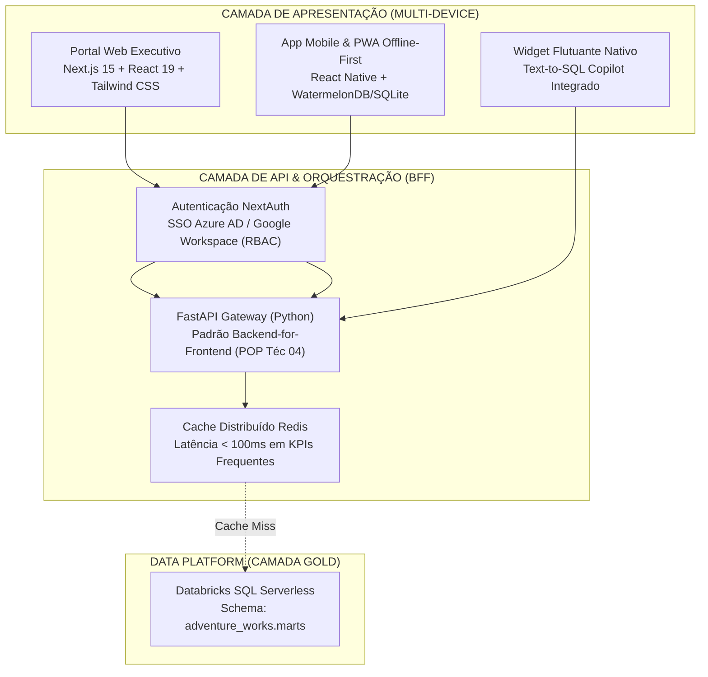

1. **Portal Web Executivo (Next.js 15 & React 19)**:
   * Construído em **Next.js 15 com App Router e TypeScript**, estilizado no Design System Dark Mode do projeto (`#1F1926`, `#7C3AED`, `#64BAAA`, `#BAA1D5`).
   * Autenticação corporativa via **NextAuth** com suporte a SSO empresarial (Azure AD / Google Workspace) e controle de acesso granular baseado em papéis (RBAC).
2. **Backend Gateway & BFF em FastAPI**:
   * Microsserviço de borda em **FastAPI (Python)** implementando o padrão *Backend-for-Frontend* (`POP Técnico 04`).
   * Conexão segura e otimizada com o Databricks SQL Warehouse Serverless via `databricks-sql-connector` autenticado com Service Principal (OAuth M2M).
   * Camada de cache distribuído em memória com **Redis**, reduzindo a latência para menos de 100ms nos cartões de KPIs mais acessados.
3. **Módulo Mobile & Suporte Offline-First (PWA / React Native)**:
   * Arquitetura **Offline-First** (`POP Técnico 56`): aplicação instalável (PWA e build React Native) com banco de dados local **WatermelonDB/SQLite**.
   * Permite que gestores e diretores consultem posições consolidadas de vendas e aprovem ordens de compra mesmo em voos ou galpões sem sinal celular, realizando sincronização em lote (*delta sync*) ao reconectar à internet.
4. **Widget Nativo do Copilot Text-to-SQL**:
   * O assistente analítico, atualmente em Streamlit, será transposto para um componente React nativo flutuante embutido na aplicação, permitindo consultas ad-hoc e exportação imediata para CSV/Excel.

---

## 10. Matriz de Riscos Técnicos e Mitigações

| Risco Mapeado | Severidade | Causa Raiz Típica | Ação Preventiva / Mitigação Obrigatória |
| :--- | :---: | :--- | :--- |
| **Custo Excessivo de Cluster Databricks** | Alta | Queries analíticas pesadas e clusters ociosos | Adoção de SQL Warehouses Serverless com auto-stop em 10 minutos e injeção mandatória de `LIMIT 200` no Copilot. |
| **Quebra de Esquema em Carga Incremental** | Crítica | Mudança não comunicada de tipos na origem OLTP | Uso de `try_cast` no dbt staging e suíte de testes de integridade (`dbt test`) bloqueando o merge no CI/CD. |
| **Alucinação ou Injeção de Prompt no Copilot** | Alta | Usuário tentando forçar comandos DDL ou acessar raw | Guardrails regex bloqueando qualquer instrução fora de `SELECT` e restrição estrita de leitura à camada `marts`. |
| **Perda de Dados em Áreas Sem Cobertura Celular** | Média | Usuários de campo operando app sem conexão | Arquitetura Mobile Offline-First com SQLite local e fila de sincronização assíncrona bidirecional. |

---

## 11. Fontes Oficiais e Referências Técnicas Consultadas

- [dbt Core Documentation](https://docs.getdbt.com/) — Modelagem dimensional, testes de schema e Jinja macros.
- [Databricks Unity Catalog Guide](https://docs.databricks.com/data-governance/unity-catalog/index.html) — Governança de dados, controle de acesso e Delta Lake.
- [Microsoft Power BI Guidance](https://learn.microsoft.com/en-us/power-bi/guidance/) — Star Schema design, DAX optimization e RLS.
- [LangChain Documentation](https://python.langchain.com/) — LCEL architecture, prompts dinâmicos e Text-to-SQL.
- [OWASP Top 10 for Large Language Model Applications](https://genai.owasp.org/) — Prevenção de prompt injection e guardrails de segurança.